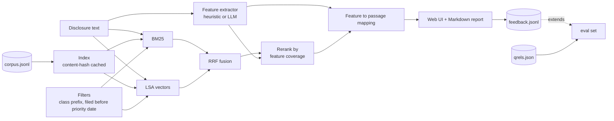

# Prior-art finder for invention disclosures

A small, runnable prototype: paste an invention disclosure, get the closest prior art from a document corpus, and see
**feature by feature** where each hit covers the disclosure (covered / partial / not found), with the matching passage
highlighted. Retrieval quality is measured with a labelled set and a one-line `eval` command.

> The corpus is **synthetic** (generated, fictional assignees, no real patent text or numbers). This is a workflow
> prototype, not a patent search tool and **not legal advice**.

## Problem

R&D and IP teams read an invention disclosure and need to answer: "what already exists that looks like this, and which
parts of our idea does it cover?" A plain ranked list is hard to act on. This prototype breaks the disclosure into
technical features, retrieves candidates with hybrid search, and shows for every candidate which features are already
disclosed, so a reviewer can decide quickly and record the decision.

## What it does

1. **Corpus**: 232 short patent-style documents (title, abstract, claims, CPC-like codes, filing date, fictional assignee)
   over four areas: battery thermal management, industrial sensors, protective coatings, additive manufacturing. Includes
   near-duplicate families, deliberately close prior art for each sample disclosure, partial matches, hard decoys that
   share vocabulary but not the mechanism, and strong matches filed *after* the priority date.
2. **Feature extraction**: deterministic clause-based extractor (default). Optional LLM extractor behind the same interface.
3. **Retrieval**: BM25 + LSA (TF-IDF with bigrams, truncated SVD), fused with reciprocal rank fusion, then reranked by
   how well each document covers the extracted features. Filters: CPC-like class prefix and "filed before priority date".
4. **Feature mapping**: for each hit, each feature is scored against every passage (title, abstract sentences, claims) with
   IDF-weighted term overlap plus LSA similarity; the best passage is shown with matched terms highlighted.
5. **Web UI**: paste or pick a sample, set priority date and class filters, read the coverage strip and mapping table,
   mark each result relevant / not relevant (saved locally), export a Markdown search report.
6. **Evals**: `eval` prints recall@10, MRR and nDCG@10 for BM25-only, LSA-only, hybrid and hybrid + rerank. Relevance
   marks saved from the UI can be merged into the eval set with `eval --with-feedback`.

Everything runs offline on CPU with no API keys.

## Architecture



Code layout: `priorart/corpus_gen.py` (synthetic data + labels), `features.py`, `retrieval.py` (index, search, mapping),
`pipeline.py` (search, feedback, report), `evals.py`, `app.py` + `static/index.html`, `__main__.py` (CLI).

## Run it

Requires Python 3.10+.

```bash
./run.sh            # creates .venv, installs requirements, serves the UI at http://localhost:8765
./run.sh test       # pytest
./run.sh eval       # retrieval evaluation table
./run.sh search D1  # CLI search for sample disclosure D1 (D1..D4)
./run.sh gen        # regenerate the corpus, sample disclosures and labels (deterministic)
```

Optional LLM feature extraction (any OpenAI-compatible chat endpoint; nothing is committed, configure via environment):

```bash
export PRIORART_FEATURE_PROVIDER=llm
export PRIORART_LLM_BASE_URL=...   # e.g. a local or hosted /v1 endpoint
export PRIORART_LLM_MODEL=...
export PRIORART_LLM_KEY=...        # if the endpoint needs one
```

On any LLM error the pipeline falls back to the deterministic extractor.

## Evaluation

Four sample disclosures (one per area). For each, the corpus contains 8 labelled relevant documents: 3 close prior-art
documents and 2 near-duplicates of them (grade 3), two documents sharing three features (grade 2) and one sharing two
(grade 1). Hard decoys and post-priority-date documents are labelled 0, and the priority-date filter is applied during
evaluation. recall@10 and MRR treat grade >= 1 as relevant; nDCG@10 uses graded gain `2^g - 1`.

Command: `./run.sh eval` (macro-average over the 4 queries, default settings):

| Retrieval | recall@10 | MRR | nDCG@10 |
|---|---|---|---|
| BM25 only | 0.906 | 1.000 | 0.941 |
| LSA only | 0.719 | 1.000 | 0.892 |
| Hybrid (BM25 + LSA, RRF) | 0.812 | 1.000 | 0.911 |
| Hybrid + feature-coverage rerank | 0.781 | 1.000 | 0.913 |

Ablation without the small synonym thesaurus (`eval --no-thesaurus`):

| Retrieval | recall@10 | MRR | nDCG@10 |
|---|---|---|---|
| BM25 only | 0.844 | 1.000 | 0.937 |
| LSA only | 0.719 | 1.000 | 0.872 |
| Hybrid (BM25 + LSA, RRF) | 0.750 | 1.000 | 0.894 |
| Hybrid + feature-coverage rerank | 0.781 | 1.000 | 0.917 |

How to read this honestly:

- **BM25 alone is the strongest here; the hybrid does not beat it.** The corpus is small (232 documents), so the LSA
  side is trained on very little text and adds noise. A pretrained embedding model would be the real test of hybrid
  search, and that is deliberately left as a next step because it needs a model download.
- MRR is 1.000 everywhere: the first hit is always relevant, so MRR does not discriminate on this set.
- The reranker mainly helps order results (it is on par with or better than plain hybrid on nDCG), and its real value is
  the feature mapping it produces, not the headline metric.
- With 4 queries and 8 relevant documents each, differences of a few hundredths are not meaningful.
- The labels are known by construction from the generator, and the thesaurus was written with the synthetic paraphrases
  in view, so these numbers are optimistic compared with real data. They demonstrate the harness, not production quality.

## Tests

`./run.sh test` runs 26 tests: feature extraction (including the LLM provider with a stubbed endpoint and fallback),
retrieval and mapping, date and class filtering, metric correctness on hand-computed values, the HTTP API (search,
feedback, report), and corpus determinism.

## Limitations

- Synthetic corpus built from templates: language is far more regular than real patents, and claims are short.
- Labels come from the generator, not from human reviewers or examiners; no inter-annotator agreement.
- The feature extractor splits on clauses and punctuation. It handles well-formed prose, not arbitrary drafting styles.
- Feature mapping is lexical overlap plus LSA, so heavy paraphrase is reported as "partial" or "not found" even when a
  human would call it covered. Thresholds were set by eye, not calibrated.
- Prior-art judgements consider only filing date, not priority claims, publication dates or jurisdiction.
- No legal conclusions: coverage statuses are a triage aid, not a novelty or patentability opinion.

## Next steps

- Real data: ingest open patent datasets and public patent office bulk feeds, plus non-patent literature, with proper
  publication-date handling and family deduplication.
- Pretrained or domain-tuned embeddings (and a cross-encoder reranker) in place of LSA, evaluated on a larger,
  independently labelled set.
- Claim charts: element-by-element charts per claim with citations to specific passages, exportable for review.
- LLM-assisted feature extraction and passage judgement with cached, auditable outputs and a human review step.
- Reviewer workflow: multi-user labels, disagreement tracking, and promoting UI feedback into a versioned eval set.
