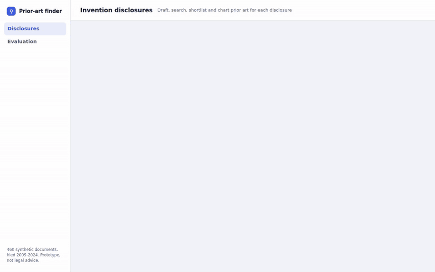
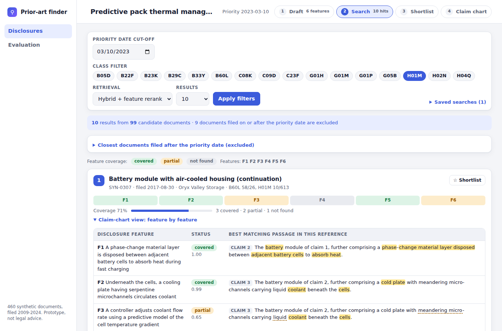
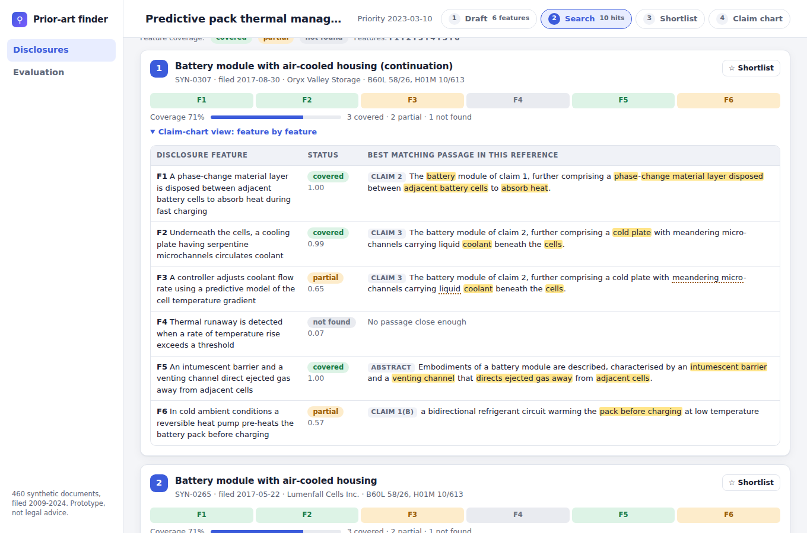
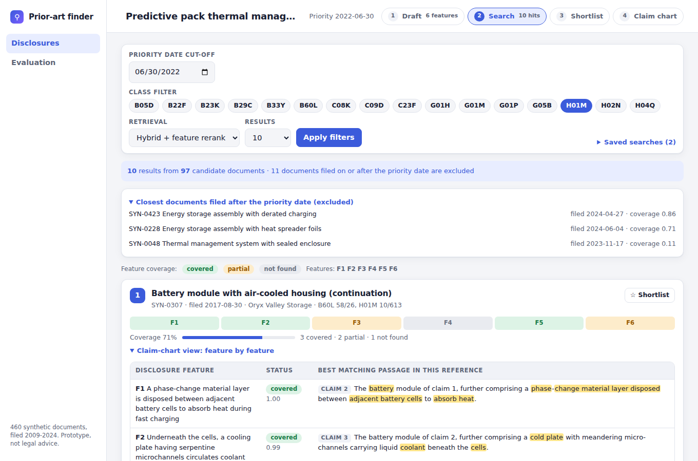
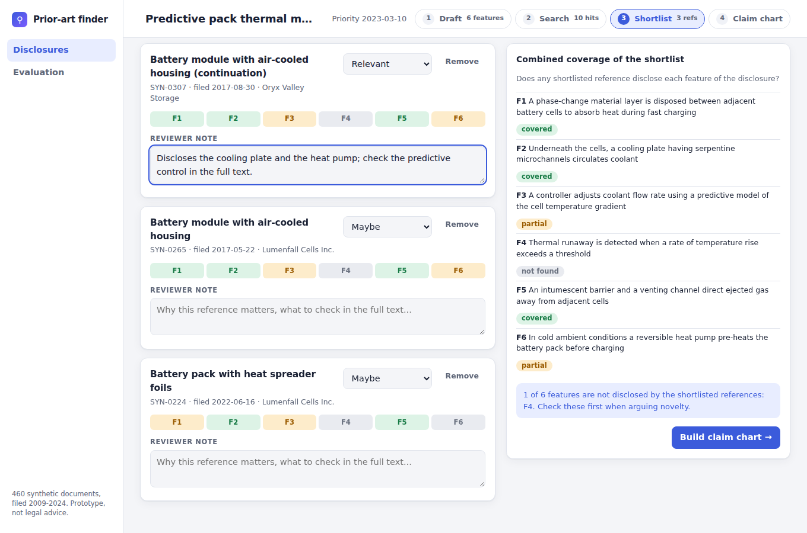
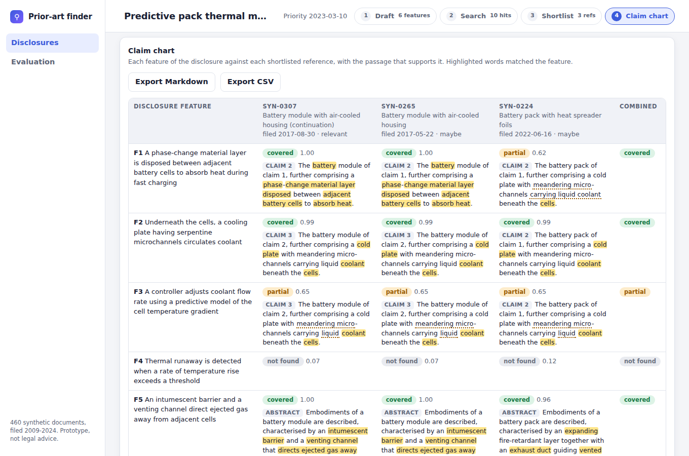
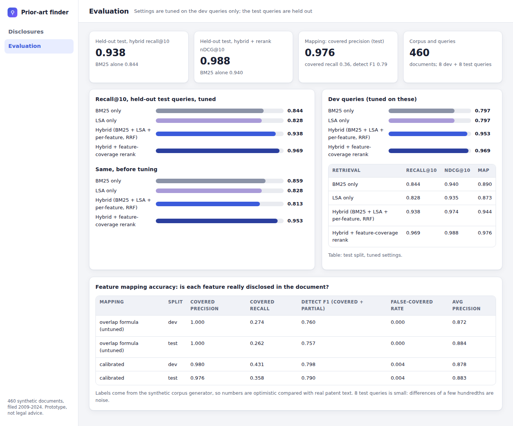
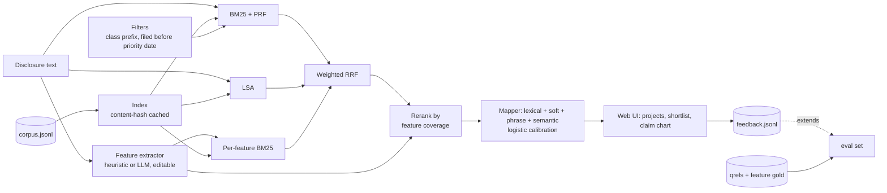

# Prior-art finder for invention disclosures



*A 17-second run of the real UI: draft a disclosure, search, open the feature-by-feature claim chart, move the priority-date cut-off, shortlist two references and export the chart ([mp4](docs/demo.mp4)).*

A runnable prototype of an IP-team workflow: write an invention disclosure, break it into technical features, search a
patent-style corpus, see **feature by feature** where each reference discloses the idea (covered / partial / not found,
with the passage highlighted), shortlist references, and export a **claim chart** as Markdown or CSV. Retrieval and
feature-mapping quality are measured on labelled queries with a dev/test split.

> The corpus is **synthetic** (generated, fictional assignees, no real patent text or numbers). This is a workflow
> prototype, not a patent search tool and **not legal advice**.

## Screenshots

All captured from the running app in headless Chrome (`./run.sh capture shots`).


*Ranked prior art for a battery-pack disclosure; each card has a per-feature coverage strip (F1-F6) and a coverage meter.*


*Claim-chart view of the top hit: each disclosure feature, its status and score, and the best passage (claim element or abstract sentence) with matched words highlighted; dotted underline = matched by similarity, not by the same word.*


*Class filter and priority-date cut-off; the closest documents filed after the priority date are listed separately so the cut-off is transparent.*


*Shortlist step of the disclosure workflow: decision and note per reference, and combined coverage showing which features no shortlisted reference discloses.*


*Claim chart (features x shortlisted references, with citations) and the Markdown / CSV export buttons.*


*Evaluation page rendered from `data/eval_report.json`: tuned vs untuned retrieval on dev and held-out test queries, and mapping accuracy.*

## The workflow

1. **Draft**: paste or type the disclosure, set the priority date and optional class filter. The deterministic extractor
   (or an optional LLM extractor) proposes key features; the reviewer edits, adds or removes them. The search and the
   claim chart use exactly this list.
2. **Search**: hybrid retrieval with date and class filters, saved searches per project (restore any earlier filter set),
   and a separate list of strong matches that were excluded because they were filed after the priority date.
3. **Shortlist**: mark references relevant / maybe / not relevant, add notes. Decisions are also stored as relevance
   feedback that can extend the eval set (`eval --with-feedback`). A combined view shows which features no shortlisted
   reference discloses.
4. **Claim chart**: features x references with status, score and a citation (document id, passage location, text), plus
   a combined column; export as Markdown or CSV.

Projects are stored in `var/projects.json` (single reviewer, no auth).

## How it works



- **Corpus**: 460 short patent-style documents (title, abstract, claims, CPC-like codes, filing date, fictional assignee)
  in four areas (battery thermal management, industrial sensors, protective coatings, additive manufacturing). For each of
  16 disclosures: 3 close prior-art documents, 2 near-duplicates, 3 partial-overlap documents, 3 hard decoys that share
  vocabulary but not the mechanism, and 2 strong matches filed after the priority date; plus 252 background documents.
- **Text analysis**: stemming with a small technical thesaurus, number and unit normalisation (`forty per cent` = `40%`,
  `micron` = `micrometre`), claim-boilerplate stripping, and claim 1 split into elements like the rows of a claim chart.
- **Retrieval**: BM25 (with pseudo-relevance feedback), LSA (TF-IDF with bigrams, truncated SVD) and a per-feature BM25
  list, fused with weighted reciprocal rank fusion, then reranked by how well each document covers the features.
- **Feature mapping**: for every (feature, passage) pair four signals are computed: IDF-weighted term overlap, overlap that
  also counts terms with similar LSA vectors, shared phrases, and passage-level LSA similarity. A logistic regression
  fitted on dev turns them into the probability that the passage discloses the feature; two dev-chosen thresholds give
  covered / partial / not found.
- **Optional neural embeddings** (`--dense`, see below) add a dense list to the fusion and a dense similarity signal.

## Run it

Requires Python 3.10+. Everything runs offline on CPU with no API keys.

```bash
./run.sh                 # creates .venv, installs requirements, serves the UI at http://localhost:8765
./run.sh test            # pytest (38 tests)
./run.sh eval            # retrieval tables (dev and test) + mapping accuracy
./run.sh report          # rewrite data/eval_report.json (rendered by the Evaluation page)
./run.sh tune            # re-tune retrieval + mapping on the DEV split only -> data/tuned.json
./run.sh search D6       # CLI search for sample disclosure D6 (D1..D16)
./run.sh gen             # regenerate corpus, disclosures, labels and feature gold (deterministic)
./run.sh capture shots   # screenshots into docs/screenshots (needs playwright + Chrome)
./run.sh capture demo    # re-record docs/demo.gif and docs/demo.mp4
```

Optional extras (`pip install -r requirements-optional.txt`): `fastembed` for neural embeddings, `playwright`,
`imageio-ffmpeg` and `pillow` for the recorder. Neural embeddings are used with `./run.sh --dense ...` or
`PRIORART_DENSE=1`; the first use downloads a 65 MB model (BAAI/bge-small-en-v1.5) into `.cache/`.

Optional LLM feature extraction (any OpenAI-compatible chat endpoint; nothing is committed, configure via environment):

```bash
export PRIORART_FEATURE_PROVIDER=llm
export PRIORART_LLM_BASE_URL=...   # e.g. a local or hosted /v1 endpoint
export PRIORART_LLM_MODEL=...
export PRIORART_LLM_KEY=...        # if the endpoint needs one
```

On any LLM error the pipeline falls back to the deterministic extractor (tested with a stubbed endpoint only).

## Evaluation

**Queries and split.** 16 labelled disclosures. 8 are **dev** (D1-D5, D8, D11, D14: two or more per area, including the
original four) and 8 are **test** (D6, D7, D9, D10, D12, D13, D15, D16). All tuning and calibration (`tune.py`,
`calibrate.py`) reads the dev split only; the test split is only used by `eval` and `report`. For each query the corpus
holds 8 labelled relevant documents (grade 3 close art and near-duplicates, grade 2 sharing three features, grade 1
sharing two); decoys and post-priority-date documents are grade 0, and the priority-date filter is applied. recall@10,
MAP and MRR treat grade >= 1 as relevant; nDCG@10 uses gain `2^g - 1`. MRR is 1.000 everywhere (the first hit is always
relevant) so it does not discriminate.

**Retrieval, held-out test queries** (macro-average over 8 queries; `./run.sh eval`):

| Retrieval | untuned recall@10 | tuned recall@10 | tuned nDCG@10 | tuned MAP |
|---|---|---|---|---|
| BM25 only | 0.859 | 0.844 | 0.940 | 0.890 |
| LSA only | 0.828 | 0.828 | 0.935 | 0.873 |
| Hybrid (BM25 + LSA + per-feature, RRF) | 0.813 | **0.938** | 0.974 | 0.944 |
| Hybrid + feature-coverage rerank | 0.953 | **0.969** | 0.988 | 0.976 |

Dev split, tuned settings: BM25 0.797, hybrid 0.953, hybrid + rerank 0.969 recall@10. Tuned settings (`data/tuned.json`):
BM25 k1 0.8, b 0.3, query-term weight count^0.5; RRF constant 40; weights BM25 1.0, LSA 0.6, per-feature 0.5;
pseudo-relevance feedback with 5 documents and 25 terms; rerank weight 0.5 on feature coverage. BM25 was tuned too, so
the comparison is fair. The earlier claim that the hybrid loses to BM25 held for the untuned fusion (0.813 vs 0.859 on
test) and is gone after tuning on dev: the per-feature list and PRF are what help, because long multi-feature queries
reward documents that touch many features. The hybrid beats BM25 on test by about 0.09 recall@10, a difference larger than
the dev/test gap but measured on only 8 queries.

**Feature mapping.** The generator knows which key feature is really disclosed in which document. Extracted features are
aligned to those gold features and every (feature, document) pair is an example: all labelled documents of a query plus 12
random background documents (about 1,200 pairs per split, 29 % positive).

| Mapping | split | covered precision | covered recall | detect F1 (covered + partial) | false-covered rate | avg precision |
|---|---|---|---|---|---|---|
| overlap formula, hand-set thresholds | test | 1.000 | 0.262 | 0.757 | 0.000 | 0.884 |
| calibrated on dev | test | 0.976 | 0.358 | 0.790 | 0.004 | 0.883 |

Calibration trades a little precision for recall and fixes the thresholds with a stated criterion (covered = at least 95 %
precision on out-of-fold dev predictions; partial = best F1). It does not fix paraphrase: **covered recall is still 0.36**
on test, so many truly disclosed features come out "partial" and a reviewer must read them. With the optional neural
embeddings the same protocol gave detect F1 0.826 and average precision 0.926 on test (one run, retrieval untuned),
so the remaining gap is semantic, not tuning.

**Neural retrieval, honestly.** On this templated corpus the small embedding model alone is weak (recall@10 0.625 on
test, untuned) and adds little to the classical fusion; I did not tune a dense configuration, and the default stays
classical.

How much to trust these numbers: labels, features and paraphrases all come from the same generator and author, so they
are optimistic compared with real patent text, and the test split protects parameter tuning, not authoring bias. The test
numbers were also looked at while building the pipeline (stemming, passage splitting), so it is held out for parameters,
not for design choices. 8 test queries is small: differences of a few hundredths are noise.

## Code layout

`corpus_gen.py` + `corpus_extra.py` (synthetic data, labels, feature gold), `features.py`, `text.py`, `retrieval.py`
(index, fusion, search), `mapping.py` (feature to passage), `calibrate.py` (mapping metric and calibration), `tune.py`,
`evals.py`, `report.py`, `pipeline.py` (search, feedback, report), `workspace.py` (projects, shortlist, claim chart),
`app.py` + `static/index.html` (API and single-page UI), `dense.py` (optional embeddings), `__main__.py` (CLI),
`scripts/capture.py` (screenshots and demo).

## Tests

`./run.sh test` runs 38 tests: feature extraction (including the LLM provider with a stubbed endpoint and fallback),
retrieval, the hybrid-vs-BM25 check on the held-out queries, mapping accuracy thresholds, metric correctness on
hand-computed values, text normalisation, date and class filtering, the project workflow API (draft, search, shortlist,
claim chart Markdown and CSV export), and corpus determinism and split hygiene.

## Limitations

- Synthetic corpus built from templates: language is far more regular than real patents and claims are short; labels and
  paraphrases come from the generator, not from examiners or human reviewers.
- Only 8 held-out test queries.
- Feature mapping still misses heavy paraphrase (covered recall 0.36 on test); statuses are a triage aid.
- Prior-art judgements use only the filing date, not priority claims, publication dates or jurisdiction.
- Single-reviewer JSON storage, no authentication or multi-user labels.
- No legal conclusions: coverage statuses are not a novelty or patentability opinion.

## Next steps

- Real data: open patent datasets and public bulk feeds, non-patent literature, publication dates and family deduplication.
- A stronger semantic layer (a domain-tuned embedding model plus a cross-encoder) evaluated on independently labelled queries.
- Per-claim charts for real claim sets, with citations to paragraphs of the full text.
- LLM-assisted feature extraction and passage judgement with cached, auditable outputs and a human review step.
- Team features: shared projects, disagreement tracking, versioned eval sets promoted from reviewer feedback.
